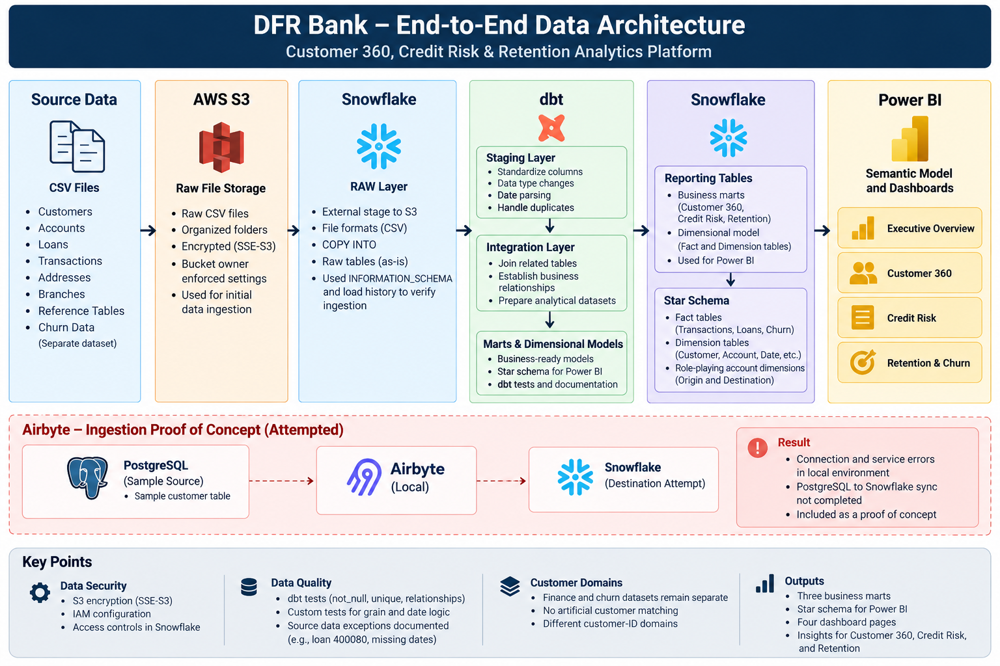
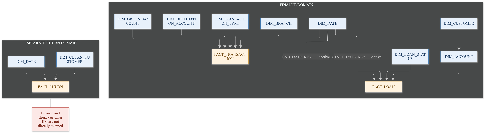
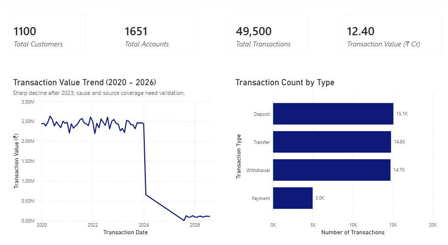
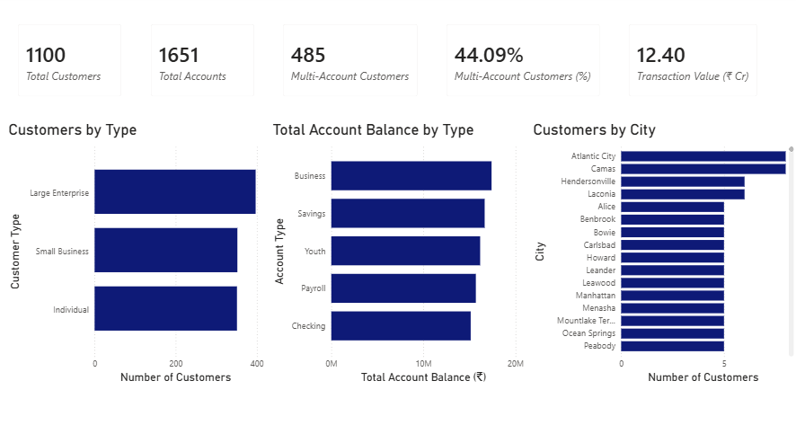
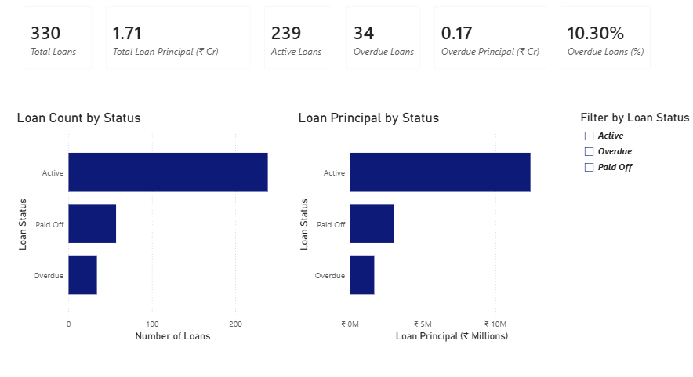
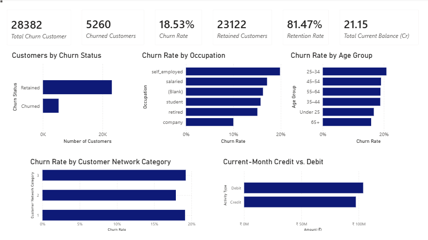

# Customer 360, Credit Risk & Retention Analytics Platform

## About the Project

DFR Bank (Digital First Retail Bank) is a fictional retail bank used for this analytics project.

Customer information, account details, loan records, transaction history, and churn data are often stored in separate systems. Bringing these datasets together makes it easier to understand customer activity, review loan performance, and identify customer retention trends.

This project demonstrates an end-to-end analytics workflow that transforms source data into reporting-ready datasets and interactive Power BI dashboards.

The project covers three main business areas:

- **Customer 360:** Customer information, accounts, balances, and transaction activity.
- **Credit Risk:** Loan status, recorded loan principal, overdue loans, and rule-based risk segments.
- **Customer Retention:** Churn, retention, customer balances, and credit/debit activity.

The project uses sample datasets and a fictional bank. Its results are intended for learning and portfolio demonstration, not for real banking or lending decisions.

## Architecture

The main data pipeline follows this flow:

**Source CSV files → AWS S3 → Snowflake RAW → dbt staging → dbt integration → reporting models and star schema → Power BI**

Raw data is kept separate from transformed data. dbt handles data standardization, integration, testing, and the creation of reporting models in Snowflake. Power BI uses the dimensional model to calculate KPIs and present the results.

## End-to-End Architecture




## Technology Stack

| Tool | Purpose |
|---|---|
| AWS S3 | Stores the source CSV files. |
| Snowflake | Loads raw data and stores transformed and reporting datasets. |
| dbt | Builds staging, integration, and mart models, along with tests and reusable SQL logic. |
| Power BI | Provides the semantic model, DAX measures, and dashboards. |
| Python | Supports the local dbt development environment. |
| Git and GitHub | Manage code changes and version control. |
| PostgreSQL and Airbyte | Used for an additional ingestion proof of concept. |

## Data Pipeline

### 1. Source Data and Snowflake RAW

Source CSV files are stored in S3 and loaded into Snowflake. The finance datasets include customers, accounts, loans, transactions, addresses, branches, and reference tables. A separate dataset contains customer churn information.

Keeping raw data separate makes it possible to compare transformed results with the original records.

### 2. Staging

The dbt staging models standardize column names and data types, handle date conversion, and remove exact duplicates where appropriate.

Some source records contain duplicate IDs or invalid dates. These issues are checked during transformation, and missing or invalid values are not automatically replaced with invented data.

### 3. Integration

The integration models combine related information, such as customer details with customer type and address, accounts with customer information, and transactions with account and reference data.

The finance and churn datasets remain separate customer domains because they do not contain a reliable shared customer identifier. No artificial customer matches are created based only on similar attributes.

### 4. Reporting Models and Star Schema

The project includes three business marts:

- `mart_customer_360`
- `mart_credit_risk`
- `mart_retention`

A dimensional model was also built for Power BI, with separate fact and dimension tables for transactions, loans, and churn.


## Dimensional Data Model

The reporting layer uses a dimensional model with fact and dimension tables to support transaction, loan, and churn analysis. Finance and churn remain separate because a verified customer mapping is not available.




## Power BI Dashboards

The Power BI report contains four pages.

### 1. Executive Overview

Provides a summary of the finance-domain customer and transaction data.

**Main KPIs:**
- Total customers: 1,100
- Total accounts: 1,651
- Total transactions: 49,500
- Total transaction value: approximately ₹12.40 crore

The page also shows transaction value over time and transaction counts by type. The chart shows a sharp decline in transaction activity after 2023. The reason has not been established, so further investigation is needed before drawing business conclusions.




### 2. Customer 360

Provides a view of customer and account distribution.

**Main KPIs:**
- Total customers: 1,100
- Total accounts: 1,651
- Customers with multiple accounts: 485
- Multi-account customers: 44.09%
- Transaction value: approximately ₹12.40 crore

The charts show customers by type, account balance by type, and customers by city.




### 3. Credit Risk

Summarizes the recorded loan portfolio.

**Main KPIs:**
- Total loans: 330
- Total loan principal: approximately ₹1.71 crore
- Active loans: 239
- Overdue loans: 34
- Overdue loan principal: approximately ₹0.17 crore
- Overdue loans: 10.30% of total loans

The charts compare loan counts and recorded principal by loan status. A loan-status slicer allows users to explore the report by status.

The risk classifications are rule-based analytical categories created for this project. They are not a validated banking credit score or regulated risk policy.




### 4. Retention & Churn

Analyzes the separate churn dataset.

**Main KPIs:**
- Churn-dataset customer records: 28,382
- Churned customers: 5,260
- Churn rate: 18.53%
- Retained customers: 23,122
- Retention rate: 81.47%
- Current-month balance: approximately ₹21.15 crore

The charts show churn status, churn rates by occupation and age group, churn rates by customer network category, and current-month credit compared with debit.

The churn dataset is not directly linked to the finance customer dataset because a reliable customer-level mapping is unavailable.




## Data Quality and Validation

Data quality checks are included throughout the project using dbt tests and Snowflake SQL queries.

Key validation results include:

- **Transaction fact:** 49,500 rows and 49,500 distinct transaction IDs.
- **Loan fact:** 330 rows and 330 distinct loan IDs.
- **Churn fact:** 28,382 rows and 28,382 distinct customer IDs.
- No invalid account, transaction-type, branch, loan-status, or checked date keys were found in the fact-table validation queries.
- Transaction, loan, and churn totals were reconciled against the corresponding integration-layer results.
- Missing source dates were measured and preserved rather than filled with invented values.

The latest selected dbt test run for the three fact models reported 21 passing tests. This result applies to that selection and does not mean every test in the project passes.

One known issue remains: loan `400080` has an estimated end date earlier than its start date. The issue is documented, and the dbt test that detects it remains active.

Other known gaps include 990 transactions with missing dates, 6 missing loan start-date keys, 6 missing loan end-date keys, and 3,223 missing churn last-transaction dates.

## Incremental Processing

The `int_transactions_incremental_demo` model demonstrates dbt incremental processing with a unique transaction key, a merge strategy, and a three-day lookback window.

The demonstration showed that the model could be rerun without creating duplicate transaction IDs. However, a three-day lookback cannot guarantee that all late-arriving records will be captured. Older records may require a backfill or reconciliation process, and source deletions need explicit handling.

This model is an educational demonstration, not the production incremental strategy for the main transaction pipeline.


## Airbyte Proof of Concept

Airbyte was installed locally, and a PostgreSQL source was configured using a sample customer table.

The Snowflake destination was also attempted, but the local environment encountered service and connection problems. The PostgreSQL-to-Snowflake sync was not completed successfully.

The main analytics pipeline was implemented separately through S3, Snowflake, and dbt. Airbyte remains an attempted proof of concept rather than a completed production ingestion connection.

## Project Structure

```text
Customer 360, Credit Risk & Retention Analytics Platform/
├── README.md
├── docs/
│   ├── images/
│   │   ├── end_to_end_architecture.png
│   │   ├── star_schema.png
│   │   ├── executive_overview.png
│   │   ├── customer_360.png
│   │   ├── credit_risk.png
│   │   └── retention_churn.png
│   └── diagrams/
│       ├── end_to_end_architecture.md
│       └── star_schema.md
├── dfr_bank_analytics/
│   ├── models/
│   ├── macros/
│   ├── seeds/
│   ├── snapshots/
│   ├── tests/
│   ├── docs/
│   └── README.md
└── dfr_bank_analytics_power_bi/
    └── dfr_bank_analyses_visual.pbix
```

The dbt folder contains transformation models, tests, macros, seed data, snapshots, and technical documentation. The Power BI folder contains the report file.

## Key Learnings

The project covers practical work with S3-to-Snowflake data loading, SQL transformations, dbt modelling and testing, star-schema design, DAX measures, and Power BI dashboards.

It also includes troubleshooting experience with IAM permissions, date conversion, duplicate records, dbt configuration, Power BI relationships, and incremental processing. These issues highlight the importance of validating results, tracing problems to their source, and documenting known limitations.

## Limitations

- The project uses sample data and a fictional bank.
- Finance and churn customer IDs cannot be reliably matched across the two datasets.
- Some source dates are missing, and one loan has an invalid date sequence.
- The reason for the decline in transaction activity after 2023 has not been established.
- The three-day incremental lookback may miss older late-arriving records.
- The Airbyte PostgreSQL-to-Snowflake sync remains incomplete.
- The credit-risk rules are project-specific and have not been validated for real lending decisions.

This project demonstrates a practical analytics workflow using sample data. It is not a production banking system.